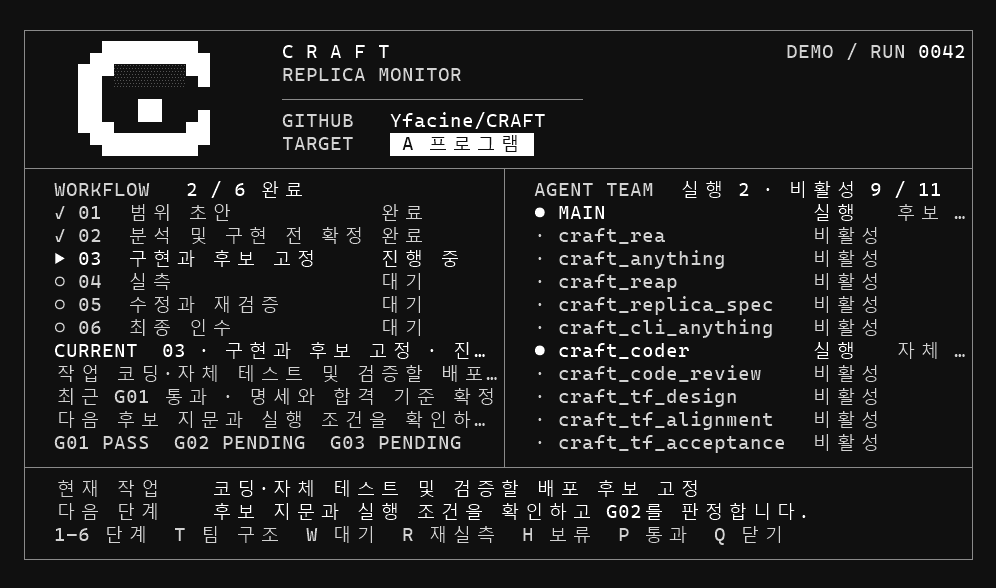
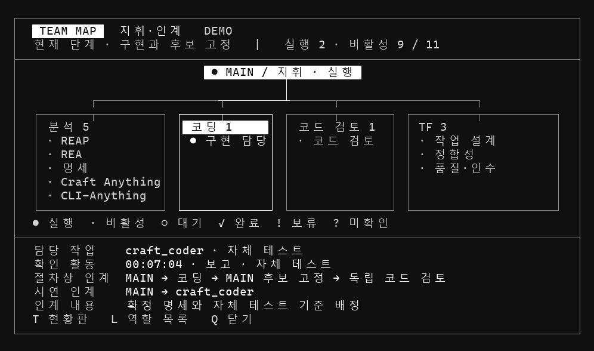

# CRAFT

상용 프로그램의 업무 흐름을 분석하고, 실제 사용 환경에서 대체할 수 있는 복제품을 만드는 작업공간입니다.

| 항목 | 값 |
| --- | --- |
| CRAFT 버전 | `v0.2.4.2` |
| 버전 기준일 | `261107` (2026-11-07, 한국 시간) |

[CRAFT 변경 이력](CHANGELOG.md)

## Windows CLI 미리보기

공개 배포본을 Windows 터미널에서 실행한 데모입니다. 이미지를 누르면 원본 크기로 볼 수 있습니다.

<table>
  <thead>
    <tr>
      <th width="50%">복제 작업 현황판</th>
      <th width="50%">팀 맵 (T)</th>
    </tr>
  </thead>
  <tbody>
    <tr>
      <td width="50%"></td>
      <td width="50%"></td>
    </tr>
  </tbody>
</table>

## 재현 후보군

CRAFT에서 실무 기능의 재현을 검토하는 소프트웨어 10종입니다. 프로그램명을 클릭하면 공식 제품 페이지로 이동합니다.

| 분야 | 프로그램 | 검토할 업무 | CRAFT 저장소 |
|---|---|---|---|
| 화재·연기 | [PyroSim](https://www.thunderheadeng.com/pyrosim/) | 3D 화재·연기 모델 작성과 FDS 해석 준비 | — |
| 보행·피난 | [Pathfinder](https://www.thunderheadeng.com/pathfinder/) | 보행자 이동·군중 흐름 모델링과 피난 시나리오 비교 | — |
| 보행·피난 | [Simulex](https://www.iesve.com/software/virtual-environment/applications/simulex) | 층별 피난 경로 설정과 대피 시간 분석 | — |
| 환기·공기질 | [CONTAM](https://www.nist.gov/el/beed/nist-multizone-modeling) | 구역 간 공기 흐름과 오염물 이동 분석 | — |
| 환기·제연 | [Ventus](https://www.thunderheadeng.com/ventus/) | 3D 화면에서 구역과 공기 흐름 경로를 모델링하고 ContamX로 풍량과 차압 분석 | — |
| 배관 해석 | [PIPENET](https://sunrise-sys.com/) | 배관망 구성과 유량·압력 해석 | — |
| CAD 도면 | [AutoCAD](https://www.autodesk.com/products/autocad/overview) | 도면 작성·편집과 반복 작업 | — |
| 차량 동선 | [Vehicle Tracking](https://www.autodesk.com/products/vehicle-tracking/overview) | 차량 회전 궤적 작성과 통과 공간 검토 | — |
| 소방설비 설계 | [Fire](https://www.dcs.co.kr/products/2) | 소방설비 배치와 배관·배선 도면 작성 | [CRAFT-FIRE](https://github.com/Yfacine/CRAFT-FIRE) |
| CAD 자동화 | [DreamPlus](https://dreamcad.net/theme/s007/index/company_01.php) | 도면 일괄 처리, 다중 출력, 반복 명령 자동화 | [CRAFT-DreamPlus](https://github.com/Yfacine/CRAFT-DreamPlus) |

## CRAFT 자체를 보완할 때

평소에는 [GitHub 저장소](https://github.com/Yfacine/CRAFT)의 `main`을 최신 작업 기준으로 사용한다. 보완할 일이 생기면 Codex에 다음 두 가지를 요청하면 된다.

1. **“`yfacine/craft`를 `E:\CRAFT`에 받아줘.”** Codex가 최신 `main`을 지정한 경로에 가져온다. **“`yfacine/craft` 다운받아줘”**처럼 경로를 생략하면 Windows 다운로드 폴더 아래 `CRAFT`에 받는다. Codex가 실제 저장 경로를 알려준다.
2. **“보완 계획서대로 수정하고 검증한 뒤, 버전을 올려 GitHub에 공개해줘.”** Codex가 변경 이력을 기록하고 검증을 통과한 변경을 `main`에 반영한다. 새 Release의 전체 ZIP과 SHA-256 체크섬까지 GitHub에서 확인한다. 작업본 정리가 필요하면 정리할 폴더를 지정한다.

검증이나 업로드가 중단되면 Codex가 작업본을 보존하고 재개할 지점을 알려준다. 설치해서 사용하는 경우 아래 Windows x64 빠른 시작을 따른다. [Codex가 따르는 보완·배포 절차](plans/01_main-plan.md#8-craft-자체-보완과-배포)

저장소를 받기 전 새 Codex 채팅에도 다운로드 기본값을 적용하려면 개인 Codex 지침에 이 저장 위치 규칙을 적어 둔다. 해당 지침이 없는 환경에서는 요청 문장에 저장 위치를 함께 적는다.

## 문서 순서

| 순번 | 문서 | 역할 |
| --- | --- | --- |
| 01 | [메인 계획서](plans/01_main-plan.md) | 목표, 역할, 작업 순서와 인계 기준 |
| 02 | [Gate](plans/02_gates.md) | 구현·실측 착수와 최종 인수의 통과 및 보류 조건 |
| 03 | [검증](plans/03_verification.md) | 확인 범위, 결과와 검증 근거 |
| 04 | [대상계획 양식](plans/04_target-plan-template.md) | 대상별 작업·증거·Gate 판정 기록 |

- [.tools 도구 버전과 가져온 날짜](plans/references/README.md#도구-도입-및-업데이트-이력)에서 현재 도구와 변경 이력을 확인합니다.

## Windows x64 빠른 시작

Windows x64에서 Codex CLI를 설치하고 로그인한다. CRAFT 전체 ZIP에는 REA와 실행용 Node.js를 포함한 도구 6종이 들어 있다.

1. GitHub Release의 전체 ZIP과 `.sha256` 파일을 받는다. `Get-FileHash -LiteralPath '<다운로드한 ZIP 경로>' -Algorithm SHA256`으로 구한 해시를 `.sha256`의 첫 값과 대조한 뒤 압축을 푼다.
2. 압축을 푼 `CRAFT` 폴더에서 **PowerShell 7 (`pwsh`)**을 열고 `.\scripts\Initialize-Craft.ps1`을 실행한다. [초기화 스크립트](scripts/Initialize-Craft.ps1)가 현재 설치 경로를 기준으로 프로젝트의 `.codex/config.toml`을 생성한다.
3. Codex에서 같은 `CRAFT` 폴더를 열고 신뢰할 수 있는 프로젝트로 설정한다. 기존에 이 폴더를 열어 둔 세션이 있다면 새 세션을 시작한다.
4. 같은 폴더에서 `codex mcp get rea --json`을 실행한다. `transport.command`, `transport.args[0]`, `transport.cwd`가 모두 압축을 푼 CRAFT 폴더를 가리키는지 확인한다.
5. Codex 세션에서 `$craft-replica` 스킬을 호출한다. 역할 이름과 인계 순서는 [메인 계획서](plans/01_main-plan.md)에 있다.

Windows PowerShell 5.1에서 스크립트 실행이 차단되면 PowerShell 7을 사용한다. 5.1만 있는 경우, 체크섬을 확인한 CRAFT 스크립트는 `powershell.exe -NoProfile -ExecutionPolicy Bypass -File .\scripts\Initialize-Craft.ps1`로 실행할 수 있다. 이 옵션은 해당 프로세스에만 적용되며 조직 정책이 적용되는 환경에서는 조직 절차를 따른다.

CRAFT를 다른 경로로 옮겼다면 새 폴더에서 초기화와 프로젝트 신뢰 설정을 다시 진행한다. 비대화형 Codex 실행에서 REA 승인 오류가 나면 [REA 호출 승인과 재현 방법](plans/references/REA.md#비대화형-codex에서-파일-읽기)을 확인한다.

## 작업 현황판

실제 대상의 복제 작업을 시작하면 CRAFT의 MAIN이 별도 현황판을 엽니다. 공식 6단계, 전체 팀 상태, 최근 활동·인계와 Gate 판정을 볼 수 있습니다. `T`는 팀 맵, `L`은 역할 목록, `Q`는 현황판 닫기입니다. [실행과 상태 기록](plans/references/Monitor.md)

## 배포와 라이선스

- Release ZIP은 CRAFT 문서·설정 소스·스크립트와 `.tools` 도구 파일을 함께 제공한다. 로컬 설정 `.codex/config.toml`, 실행 상태 `.craft-monitor/`, 내부 Git 관리 정보와 `dist/`는 공개 사본에서 분리한다.
- Git에 등록할 공개 사본에도 `.tools` 파일을 포함한다. 내장 도구의 버전·도입일과 공식 출처는 [도구 이력](plans/references/README.md)에 있다.
- 내장 도구를 새로 넣거나 교체할 때는 원본 `.gitignore` 때문에 배포할 파일이 누락되지 않았는지 확인한다. 필요한 파일만 명시적으로 등록한다.
- CRAFT 자체 파일은 [Yfacine](https://github.com/Yfacine)의 [MIT 라이선스](LICENSE)를 따른다. 외부 도구에는 [각 라이선스와 고지](THIRD-PARTY-NOTICES.md)가 적용된다.
